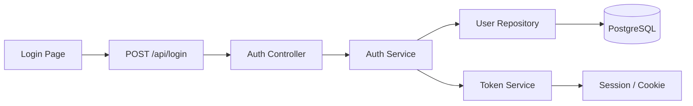
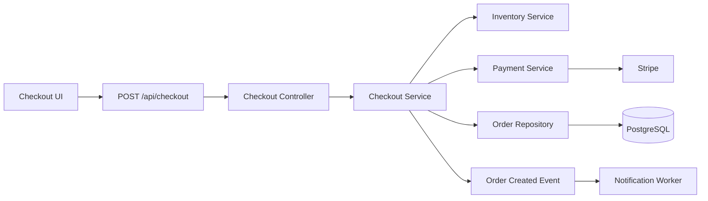
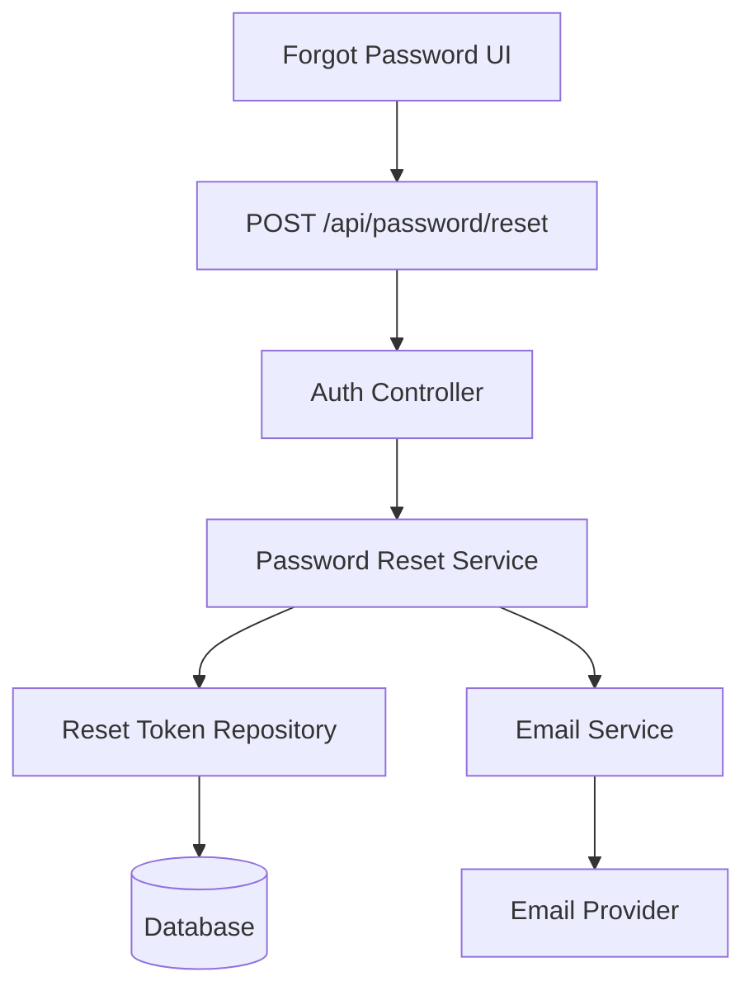
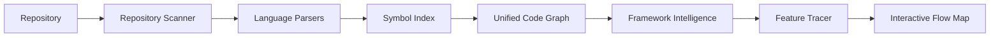

<div align="center">

# Flowlyra

### Understand features, not files.

**Open-source code intelligence for exploring how features actually move through a codebase.**

Trace a feature from **UI → API → service → database → external systems** and turn an unfamiliar repository into an interactive feature-flow map.

<br />

[](https://github.com/adnan425/Flowlyra/stargazers)
[](https://github.com/adnan425/Flowlyra/network/members)
[](https://github.com/adnan425/Flowlyra/issues)
[](LICENSE)

<br />

**⭐ Star Flowlyra if you want a better way to understand large codebases.**

</div>

---

> [!IMPORTANT]
> **Flowlyra is in early development.**
>
> The project is being built in public. The examples below describe the intended Flowlyra experience and are not yet a released CLI/API.

## The problem

Developers rarely think about software as files.

We think about **features**.

> How does authentication work?

> What happens when a customer checks out?

> Where does an uploaded file go?

> What happens after an order is created?

> How are notifications sent?

But an unfamiliar repository gives you this:

```text
src/
├── components/
├── controllers/
├── middleware/
├── models/
├── repositories/
├── routes/
├── services/
├── utils/
└── workers/
```

So understanding one feature means searching filenames, following imports, jumping between services, finding API calls, tracing database access, checking events, and trying to reconstruct the architecture in your head.

**Flowlyra is being built to do that tracing for you.**

---

## See the feature end-to-end

The intended experience is simple:

```bash
flowlyra trace "user login"
```

And instead of returning a list of matching files, Flowlyra builds the feature flow:



Every node should be connected back to the source code responsible for it.

```text
Auth Service
└─ src/services/auth.service.ts:42

User Repository
└─ src/repositories/user.repository.ts:18

POST /api/login
└─ src/routes/auth.ts:27
```

### You ask about the feature.

### Flowlyra finds the code path.

---

## Feature-first code exploration

Traditional code navigation starts with:

```text
file → symbol → reference → another file → another symbol
```

Flowlyra starts with:

```text
feature → entry point → execution path → dependencies → data → outcome
```

For example:

```bash
flowlyra trace "checkout"
```

Could produce:



Now a developer can see **how checkout works as a system**, rather than opening twenty files individually.

---

# What Flowlyra is

Flowlyra is an open-source **code intelligence and code visualization tool** designed to transform source-code relationships into understandable feature flows.

The project is being designed around:

* **Feature tracing** — follow authentication, checkout, uploads, notifications, payments, search, and other product behavior.
* **Codebase visualization** — convert relationships between code into navigable visual graphs.
* **Static analysis** — understand code structure without requiring the application to execute.
* **Call graph analysis** — follow relationships between functions, methods, services, and modules.
* **Dependency analysis** — understand what each feature depends on.
* **API tracing** — connect frontend requests to backend routes and handlers.
* **Data-flow analysis** — follow data through services, repositories, databases, queues, and external APIs.
* **Source navigation** — every visual node should lead back to its implementation.
* **Framework awareness** — understand framework conventions rather than treating every repository identically.
* **Developer onboarding** — help engineers understand unfamiliar and legacy codebases faster.

---

## The vision

Imagine cloning a repository you've never seen before.

Instead of spending an hour searching through it, you ask:

```text
How does password reset work?
```

Flowlyra maps:



Then ask:

```text
How are payments processed?
```

Or:

```text
What happens after signup?
```

Or:

```text
Where does file upload go?
```

Or:

```text
How are notifications delivered?
```

Flowlyra's job is to turn each answer into an **explorable code path**.

---

# How it will work



### 1. Scan

Discover source files, frameworks, configuration, APIs, packages, and project structure.

### 2. Parse

Extract meaningful code relationships using language-aware parsing and AST analysis.

### 3. Build the graph

Connect:

```text
components
functions
classes
routes
controllers
services
repositories
models
events
queues
database access
external APIs
```

### 4. Understand frameworks

Recognize conventions from frameworks such as Next.js, Express, NestJS, FastAPI, Django, Spring Boot, Laravel, Rails, and others.

### 5. Trace the feature

Find likely entry points and follow relationships through the repository.

### 6. Visualize

Turn the discovered path into an interactive graph with links back to the source.

---

# Planned CLI

> The CLI syntax below represents the intended interface.

### Trace a feature

```bash
flowlyra trace "authentication"
```

### Trace checkout

```bash
flowlyra trace "checkout"
```

### Trace from a symbol

```bash
flowlyra trace AuthService.login
```

### Analyze a repository

```bash
flowlyra analyze .
```

### Generate a flow map

```bash
flowlyra trace "file upload" --output flow.html
```

### Export a diagram

```bash
flowlyra trace "checkout" --format mermaid
```

---

# What makes Flowlyra different?

There are already excellent tools for:

* browsing repository trees
* searching source code
* generating architecture diagrams
* exploring dependency graphs
* building documentation
* chatting with repositories

Flowlyra's focus is narrower:

> **Start with a product feature and reconstruct the code path that makes that feature work.**

The unit of exploration is not the file.

It's the **feature flow**.

---

# Designed for

### New engineers

Understand an unfamiliar repository without asking:

> “Which files should I start with?”

### Open-source contributors

Learn how a feature works before making the first contribution.

### Maintainers

Explain complex flows without manually maintaining architecture diagrams.

### Code reviewers

Understand the surrounding execution path of the code being changed.

### Students

See how real applications connect frontend, backend, databases, and services.

### Legacy codebases

Reconstruct architecture when documentation is missing or outdated.

### AI coding workflows

Provide structured codebase context that coding agents and LLM-powered developer tools can reason about.

---

# Principles

### Feature-first

Flowlyra should answer **“How does X work?”**, not just **“Where is X?”**

### Source-linked

A beautiful graph is useless if you cannot verify it.

Every important node should point back to source code.

### Evidence over hallucination

Flowlyra should distinguish between relationships discovered from code and relationships inferred with lower confidence.

### Static-analysis first

The core graph should come from deterministic code analysis whenever possible.

AI can help with understanding and ranking, but it should not be the only source of truth.

### Local-friendly

Developers should be able to analyze private repositories without being forced to upload their source code to a third-party service.

### Extensible

Languages and frameworks should be implementable through modular analyzers so the community can expand support.

---

# Roadmap

## v0.1 — Build the graph

* [ ] Repository scanner
* [ ] JavaScript / TypeScript parsing
* [ ] Symbol extraction
* [ ] Import graph
* [ ] Function relationships
* [ ] Basic call graph
* [ ] Route detection
* [ ] CLI foundation
* [ ] Mermaid output

## v0.2 — Trace features

* [ ] Feature entry-point discovery
* [ ] Frontend → API mapping
* [ ] Controller → service tracing
* [ ] Database-access detection
* [ ] External API detection
* [ ] Source-linked nodes
* [ ] Trace confidence scoring

## v0.3 — Interactive explorer

* [ ] Web-based flow explorer
* [ ] Search by feature
* [ ] Expand / collapse flows
* [ ] Jump to source
* [ ] Flow filtering
* [ ] SVG export
* [ ] HTML export
* [ ] Shareable diagrams

## v0.4 — Framework intelligence

* [ ] Next.js
* [ ] Express
* [ ] NestJS
* [ ] FastAPI
* [ ] Django
* [ ] Spring Boot
* [ ] Laravel
* [ ] Rails

## Later

* [ ] Python analysis
* [ ] Java analysis
* [ ] Go analysis
* [ ] Rust analysis
* [ ] PHP analysis
* [ ] Event and message-queue tracing
* [ ] Background-job tracing
* [ ] GitHub integration
* [ ] VS Code extension
* [ ] Pull-request flow analysis
* [ ] Architecture-change visualization
* [ ] Plugin SDK

---

# Open-source architecture

One goal is to make adding support for a new ecosystem approachable.

A possible structure:

```text
flowlyra/
├── packages/
│   ├── cli/
│   ├── core/
│   ├── graph/
│   ├── tracer/
│   └── renderer/
│
├── languages/
│   ├── javascript/
│   ├── typescript/
│   ├── python/
│   ├── java/
│   └── go/
│
├── frameworks/
│   ├── nextjs/
│   ├── express/
│   ├── nestjs/
│   ├── django/
│   ├── fastapi/
│   └── spring/
│
└── fixtures/
    └── example-projects/
```

That means contributors shouldn't need to understand the entire Flowlyra codebase before adding support for one framework.

---

# Contributing

Flowlyra is being built in public.

If the idea interests you, we'd love contributions involving:

* compiler and AST tooling
* static analysis
* call graphs
* dependency graphs
* JavaScript / TypeScript
* Python
* framework detection
* visualization
* graph algorithms
* developer tooling
* documentation
* testing
* UI / UX

You can contribute even before the first release.

### Great early contributions

* Propose how the unified graph should represent code.
* Build a small framework detector.
* Create repository fixtures for testing.
* Research AST and call-graph approaches.
* Improve the CLI design.
* Prototype graph visualizations.
* Improve documentation.
* Open an issue describing a feature flow that Flowlyra should support.

Check the [Issues](https://github.com/adnan425/Flowlyra/issues) page to get involved.

---

# Help shape the project

Flowlyra is early enough that contributors can influence its architecture instead of only fixing small bugs after everything has already been decided.

If you've ever opened a large repository and thought:

> **“I don't want to know where the files are. I want to know how this feature works.”**

Flowlyra is for you.

⭐ **Star the repository** to follow development.

👀 **Watch the repository** for releases and contributor issues.

🍴 **Fork it** if you want to experiment with the idea.

💬 **Open an issue** if you have a feature, framework, or architecture suggestion.

---

# Search & ecosystem

Flowlyra sits at the intersection of:

**code intelligence · code visualization · codebase analysis · static analysis · call graphs · dependency graphs · software architecture · architecture visualization · code navigation · program analysis · repository analysis · developer tools · developer onboarding · source-code analysis · AST analysis · data-flow analysis · API tracing · code comprehension · open source**

---

# License

Flowlyra is open source under the [MIT License](LICENSE).

---

<div align="center">

### Flowlyra

**Understand features, not files.**

Built in the open for developers who want to understand codebases faster.

[⭐ Star](https://github.com/adnan425/Flowlyra) · [🐛 Issues](https://github.com/adnan425/Flowlyra/issues) · [🛠 Contribute](https://github.com/adnan425/Flowlyra/issues)

</div>
